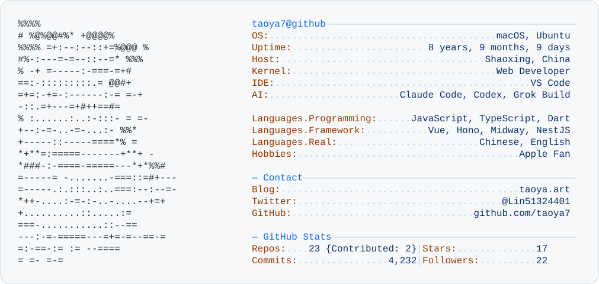

<a href="https://taoya.art">
  <picture>
    <source media="(prefers-color-scheme: dark)" srcset="assets/dark_mode.svg">
    
  </picture>
</a>

## 💫 Tech Stack and Tools

| Category | Tools |
| :-- | :-- |
| **💻 Languages** |     |
| **🎨 Frontend** |   |
| **⚙️ Backend** |     |
| **🐳 DevOps** |    |
| **🍎 Platform** |   |
| **🤖 AI** |    |
